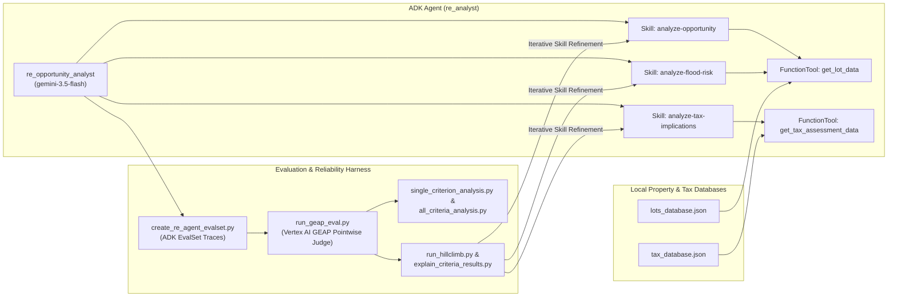

# Step-by-Step Lab Manual: Evaluating ADK Agents with Autoraters, Intra-Rater Reliability & Hill-Climbing

This guide walks through setting up, evaluating, analyzing intra-rater reliability (Krippendorff's Alpha & Pairwise Agreement), and hill-climbing the **Real Estate Investment Opportunity Analysis Agent (`re_analyst`)** built with the **Google Agent Development Kit (ADK)** and evaluated using **Vertex AI Gen AI Evaluation Service (LLM-as-a-Judge / GEAP)**.

---

## Architecture Overview



### Repository Structure

```text
autoraters/
├── .env.example                           # Example environment configuration
├── .gitignore                             # Git ignore rules
├── README.md                              # Project overview & Step-by-Step Manual
├── STEP_BY_STEP_MANUAL.md                 # Full Step-by-Step Manual
├── best_criteria_submission.txt           # Top 3 reliable autorater criteria IDs
├── requirements.txt                       # Python 3.13 dependencies (google-adk, vertexai, krippendorff)
├── eval_harness/
│   ├── create_re_agent_evalset.py         # Runs ADK agent concurrently over target lots to create EvalSet traces
│   ├── run_geap_eval.py                   # Dispatches k-pass LLM-as-a-Judge evaluations to Vertex AI GEAP
│   ├── single_criterion_analysis.py       # Detailed N x k score matrix & reliability stats for 1 criterion
│   ├── all_criteria_analysis.py           # Summary table of reliability metrics across all 19 criteria
│   ├── explain_criteria_results.py        # Inspects LLM judge rationales for low-scoring passes
│   ├── run_hillclimb.py                   # Automated hill-climbing loop for cost-per-acre & neighboring-flood-risk
│   ├── metrics_calc.py                    # Krippendorff's Alpha, Pairwise Agreement, and SD calculations
│   ├── rubrics.json                       # 19 evaluation rubric criteria & 1-5 scoring definitions
│   └── hillclimb_lots.txt                 # 10 target property Lot IDs for evaluation & hill-climbing
├── re_analyst/
│   ├── agent.py                           # Root ADK Agent (re_opportunity_analyst) & SkillToolset config
│   ├── hillclimb_lots.evalset.json        # Initial 10-property ADK trace dataset
│   ├── hillclimb_1.evalset.json           # Hill-climb run 1 ADK trace dataset (baseline)
│   ├── hillclimb_2.evalset.json           # Hill-climb run 2 ADK trace dataset (5.0000 score)
│   ├── tools/
│   │   ├── lot_tool.py                    # FunctionTool: get_lot_data(lot_id)
│   │   └── tax_tool.py                    # FunctionTool: get_tax_assessment_data(parcel_apn)
│   └── skills/
│       ├── analyze-opportunity/SKILL.md   # Core site evaluation, adjacent lot lookup & cost-per-acre skill
│       ├── analyze-flood-risk/SKILL.md    # FEMA flood zone & neighboring hydrological impact skill
│       └── analyze-tax-implications/SKILL.md # Official tax lookup & monthly holding cost skill
├── runs/
│   ├── baseline/                          # k=3 baseline GEAP evaluation calls & responses
│   ├── hillclimb_1/                       # Hill-climb iteration 1 GEAP results (Mean: 1.10 / 1.10)
│   └── hillclimb_2/                       # Hill-climb iteration 2 GEAP results (Mean: 5.00 / 5.00)
└── tools_data/
    ├── lots_database.json                 # County parcel attributes database
    └── tax_database.json                  # County tax assessment database by APN
```

---

## Task 1: Set Up Your Environment

### 1.1 Authenticate & Download the Codebase
In Cloud Shell, authenticate your environment and copy the `autoraters` codebase from the lab Cloud Storage bucket:

```bash
gcloud auth application-default login
export PROJECT_ID=$(gcloud config get-value project)
gcloud storage cp -r gs://${PROJECT_ID}-bucket/autoraters .
```

### 1.2 Install Python 3.13 via `pyenv` & Install Lab Dependencies
```bash
sudo apt-get update
sudo apt-get install -y libreadline-dev
curl https://pyenv.run | bash

echo 'export PYENV_ROOT="$HOME/.pyenv"' >> ~/.bashrc
echo 'command -v pyenv >/dev/null || export PATH="$PYENV_ROOT/bin:$PATH"' >> ~/.bashrc
echo 'eval "$(pyenv init -)"' >> ~/.bashrc
source ~/.bashrc

pyenv install 3.13
pyenv global 3.13
python3 -m pip install -r ~/autoraters/requirements.txt
```

### 1.3 Configure `.env` and Active Project
```bash
cd ~/autoraters
cat << EOF > .env
GOOGLE_GENAI_USE_VERTEXAI=TRUE
GOOGLE_CLOUD_PROJECT=${PROJECT_ID}
GOOGLE_CLOUD_LOCATION=global
MODEL=gemini-3.5-flash
EOF

gcloud config set project ${PROJECT_ID}
```

---

## Task 2: Run, Test, and Understand the Agent

Start the ADK Web UI from the `~/autoraters` directory:

```bash
cd ~/autoraters
adk web --allow_origins "regex:https://.*\.cloudshell\.dev"
```

1. Click `http://127.0.0.1:8000` in the terminal output to open the ADK Dev UI.
2. Select **`re_analyst`** from the top-left dropdown.
3. Test the agent with the following prompt:
   ```text
   Please evaluate investment suitability for lot LOT-8472 and generate a report.
   ```
4. Observe the execution trace as `re_opportunity_analyst` loads skills from `re_analyst/skills/`, invokes `get_lot_data` and `get_tax_assessment_data`, and generates an **Initial Site Evaluation Memorandum**.

---

## Task 3: Generate Agent Responses (Evaluation Dataset)

Generate an ADK evaluation dataset (`./re_analyst/hillclimb_lots.evalset.json`) by executing `re_analyst` concurrently across the 10 target lots in `eval_harness/hillclimb_lots.txt`:

```bash
cd ~/autoraters
source ~/.bashrc
pyenv global 3.13
gcloud config set project ${PROJECT_ID}

python3 -m eval_harness.create_re_agent_evalset \
  --lots-file eval_harness/hillclimb_lots.txt \
  --out ./re_analyst/hillclimb_lots.evalset.json \
  --agent-dir ./re_analyst
```

---

## Task 4: Evaluate the Agent Responses with LLM-as-a-Judge

### Step 1: Perform a Dry Run to Inspect Evaluator Prompts
Compile the evaluation prompts from `eval_harness/rubrics.json` locally without making live cloud API calls:

```bash
cd ~/autoraters
python3 -m eval_harness.run_geap_eval \
  --traces re_analyst/hillclimb_lots.evalset.json \
  --rubric-file eval_harness/rubrics.json \
  --out runs/baseline/geap_calls_and_responses.json \
  --experiment-name rubric-agreement-check \
  --dry-run \
  --k 3
```

### Step 2: Execute Live Cloud Evaluations (`k=3` Passes)
Dispatch live evaluation calls to the Vertex AI Gen AI Evaluation Service across 3 passes per property:

```bash
python3 -m eval_harness.run_geap_eval \
  --traces re_analyst/hillclimb_lots.evalset.json \
  --rubric-file eval_harness/rubrics.json \
  --out runs/baseline/geap_calls_and_responses.json \
  --experiment-name rubric-agreement-check \
  --k 3
```

---

## Task 5: Analyze Autorater Intra-Rater Reliability

Using the 32-lot × 19-criteria × 15-pass dataset in `runs/geap_calls_and_responses_for_analysis.json`, evaluate which rubric criteria exhibit genuine intra-rater reliability.

### Step 1: Deep-Dive into an Individual Criterion
```bash
cd ~/autoraters
python3 -m eval_harness.single_criterion_analysis \
  --run_geap_eval_out runs/geap_calls_and_responses_for_analysis.json \
  --criterion environmental-esa
```

### Step 2: View Summary Metrics Across All 19 Criteria
```bash
cd ~/autoraters
python3 -m eval_harness.all_criteria_analysis \
  --run_geap_eval_out runs/geap_calls_and_responses_for_analysis.json
```

#### Full 19-Criteria Reliability Output
```text
=== GEAP Evaluation Metrics Summary ===
| criterion_id           | criterion_name                                | mean   | min    | max    | max range | max range | sd report | sd pass | pairwise | alpha |
|                        |                                               |        | rating | rating | report    | pass      | means     | means   | %_agree  |       |
| ---------------------- | --------------------------------------------- | ------ | ------ | ------ | --------- | --------- | --------- | ------- | -------- | ----- |
| analyst-insight        | Deep Analyst Insights                         | 4.7294 |      4 |      5 |         1 |         1 |     0.257 |  0.0576 |   71.59% | 0.639 |
| core-specifications    | Explicit Plot Core Specifications             | 4.3623 |      4 |      5 |         1 |         1 |    0.2648 |  0.0765 |   65.05% | 0.621 |
| cost-per-acre          | Acquisition Cost-Per-Acre Calculation         | 1.3771 |      1 |      3 |         2 |         2 |    0.2163 |  0.0511 |   58.97% | 0.565 |
| data-density           | Information and Data Density                  | 4.9979 |      4 |      5 |         1 |         1 |    0.0118 |  0.0081 |   99.58% | 0.499 |
| document-formatting    | Document Readability & Formatting             | 4.8361 |      4 |      5 |         1 |         1 |    0.1488 |  0.0487 |   75.22% | 0.548 |
| environmental-esa      | Environmental Status (Phase I ESA) Evaluation | 4.2772 |      2 |      5 |         3 |         3 |    0.7042 |  0.0991 |   79.10% | 0.897 |
| flood-zone-flagging    | Precise Flood Zone Flagging                   | 4.8447 |      3 |      5 |         1 |         2 |    0.3357 |  0.0256 |   94.41% | 0.897 |
| general-tone           | General Tone Suitability                      |      5 |      5 |      5 |         0 |         0 |         0 |       0 |  100.00% |     1 |
| logical-flow           | Logical Narrative Flow                        |      5 |      5 |      5 |         0 |         0 |         0 |       0 |  100.00% |     1 |
| monthly-tax-holding    | Monthly Tax Holding Cost Calculation          | 2.2764 |      2 |      5 |         1 |         3 |    0.8872 |  0.0228 |   99.17% | 0.997 |
| neighboring-flood-risk | Neighboring Property Flood Risk Analysis      | 1.0316 |      1 |      2 |         0 |         1 |    0.1768 |  0.0009 |  100.00% |     1 |
| persuasiveness         | Document Persuasiveness                       |  4.884 |      4 |      5 |         1 |         1 |    0.2022 |  0.0395 |   86.51% | 0.672 |
| professional-tone      | Professional Tone                             | 4.9958 |      4 |      5 |         1 |         1 |    0.0164 |   0.011 |   99.17% | 0.498 |
| professionalism        | Analyst Professionalism                       |      5 |      5 |      5 |         0 |         0 |         0 |       0 |  100.00% |     1 |
| readability            | General Reading Ease                          |      5 |      5 |      5 |         0 |         0 |         0 |       0 |  100.00% |     1 |
| report-length          | Report Detail and Length                      | 4.7622 |      4 |      5 |         1 |         1 |    0.1715 |  0.0721 |   67.20% | 0.549 |
| risk-assessment        | Comprehensive Risk Assessment                 | 4.9532 |      3 |      5 |         2 |         2 |    0.1843 |  0.0306 |   96.25% | 0.803 |
| utility-topography     | Utility & Topography Evaluation               | 4.7756 |      4 |      5 |         1 |         1 |    0.3081 |  0.0695 |   82.57% | 0.751 |
| vocabulary-choice      | Advanced Real Estate Vocabulary               | 4.9349 |      4 |      5 |         1 |         1 |    0.1365 |  0.0391 |   90.83% | 0.623 |
```

### Step 3: Select & Upload Top 3 Reliable Criteria
- **Why avoid `general-tone`, `logical-flow`, `professionalism`, `readability`, and `neighboring-flood-risk`?** They suffer from the **homogeneity trap** (`sd_report_means = 0` or near-zero because almost every report received the exact same score).
- **Top 3 Reliable Criteria** (high Krippendorff's `alpha > 0.89`, high pairwise agreement, and strong `sd_report_means` discrimination across reports):
  1. `monthly-tax-holding` (`alpha = 0.997`, `pairwise %_agree = 99.17%`, `sd_report_means = 0.8872`)
  2. `flood-zone-flagging` (`alpha = 0.897`, `pairwise %_agree = 94.41%`, `sd_report_means = 0.3357`)
  3. `environmental-esa` (`alpha = 0.897`, `pairwise %_agree = 79.10%`, `sd_report_means = 0.7042`)

Save and upload `best_criteria_submission.txt`:
```bash
echo -n "monthly-tax-holding,flood-zone-flagging,environmental-esa" > ~/autoraters/best_criteria_submission.txt
gcloud storage cp ~/autoraters/best_criteria_submission.txt gs://${PROJECT_ID}-bucket/best_criteria_submission.txt
```

---

## Task 6: Hill-Climb Agent Skills to Raise Autorater Criteria Scores

### Step 1: First Hill-Climbing Run (`hillclimb_1`)
```bash
cd ~/autoraters
python3 -m eval_harness.run_hillclimb
```
**Baseline Output (`hillclimb_1`)**:
```text
=========================================
📊 Hill Climbing Results: hillclimb_1
=========================================
 • cost-per-acre             Mean Score: 1.1000
 • neighboring-flood-risk    Mean Score: 1.1000
=========================================
```

### Step 2: Analyze Judge Explanations (`explain_criteria_results.py`)
```bash
cd ~/autoraters
python3 -m eval_harness.explain_criteria_results \
   --run_geap_eval_out runs/hillclimb_1/geap_calls_and_responses_hillclimb_1.json \
   --criterion cost-per-acre \
   --max_score_to_show 4.0

python3 -m eval_harness.explain_criteria_results \
   --run_geap_eval_out runs/hillclimb_1/geap_calls_and_responses_hillclimb_1.json \
   --criterion neighboring-flood-risk \
   --max_score_to_show 4.0
```

### Step 3: Update Agent Skills (`re_analyst/skills/*/SKILL.md`)

#### 1. `re_analyst/skills/analyze-opportunity/SKILL.md`
```markdown
---
name: analyze-opportunity
description: Investigates a land parcel for real estate investment opportunity analysis.
metadata:
  adk_additional_tools:
    - get_lot_data
---
# Analyze Opportunity Skill

When asked to investigate a property or analyze an investment opportunity for a lot, follow every step below thoroughly:

1. **Retrieve Subject Parcel Data**:
   - Use the `get_lot_data` tool to lookup the subject property attributes by its `plot_id`.
   - Explicitly record and present the core specifications (`plot_id`, exact `acreage`, `zoning`, `parcel_apn`, `last_sale_price`, `flood_zone`, `topography`, `utility_access`, and `environmental_status`) in both a structured Markdown summary table and the body text.

2. **Retrieve All Neighboring / Adjacent Parcels Data (`adjacent_parcels`)**:
   - Inspect the `adjacent_parcels` list in the subject lot's data.
   - You MUST call `get_lot_data` for **every** parcel ID listed in `adjacent_parcels` so you can report their exact FEMA `flood_zone` designations, `topography`, `soil_classification`, `easement_type`, `last_sale_price`, and `acreage`.

3. **Calculate & Benchmark Acquisition Cost-Per-Acre (Core Valuation Metric)**:
   - Derive and state the exact mathematical **Acquisition Cost-Per-Acre** from `last_sale_price` and `acreage` using the explicit formula:
     $$\text{Acquisition Cost-Per-Acre} = \frac{\text{Last Sale Price}}{\text{Acreage}} = \frac{\$\text{[last\_sale\_price]}}{\text{[acreage] acres}} = \$\text{[exact value] per acre}$$
   - Always show the full equation and exact numerical result (to 2 decimal places if non-integer), even when acreage is `1.0` acre.
   - Prominently highlight **Acquisition Cost-Per-Acre** in bold and in summary tables in both the **Executive Summary** and **Acquisition Basis and Holding Costs** sections, explicitly labeling it as a **Core Valuation Metric**.
   - Benchmark the subject parcel's cost-per-acre against the adjacent parcels' cost-per-acre (computed from the adjacent parcels' `last_sale_price` and `acreage`) and against typical market land basis for its zoning classification.

4. **Execute Flood, Neighboring Hydrological, and Environmental Analysis**:
   - Consult and load the `analyze-flood-risk` skill to evaluate the subject lot's FEMA flood zone, environmental Phase I/II ESA status, AND to perform a comprehensive comparative hydrological and flood risk analysis of all neighboring/adjacent properties (`adjacent_parcels`).

5. **Execute Tax & Monthly Carrying Cost Analysis**:
   - Consult and load the `analyze-tax-implications` skill to retrieve official tax records via `get_tax_assessment_data` using `parcel_apn` and explicitly calculate the monthly tax holding cost ($\text{Annual Taxes} \div 12$).
```

#### 2. `re_analyst/skills/analyze-flood-risk/SKILL.md`
```markdown
---
name: analyze-flood-risk
description: Investigates flood zone designations, neighboring property flood risks, and environmental risks for real estate investment opportunity analysis.
metadata:
  adk_additional_tools:
    - get_lot_data
---
# Analyze Flood Risk Skill

When evaluating environmental, hydrological, or geographic risks for a lot, you MUST perform all three investigations below and include them in the final memorandum:

1. **Subject Parcel FEMA Flood Zone Flagging & Engineering/Insurance Impacts**:
   - Explicitly state the subject parcel's exact FEMA `flood_zone` designation (e.g., `Zone AE (High Risk)`, `Zone VE (Coastal High Hazard)`, `Zone X (Minimal Risk)`).
   - Explain specific vertical construction and site engineering impacts:
     - For `Zone AE` or `Zone A`: Base Flood Elevation (BFE) compliance, imported structural fill dirt requirements to elevate building pads, elevated mechanical/electrical systems, foundation waterproofing, and mandatory National Flood Insurance Program (NFIP) flood insurance premiums.
     - For `Zone VE`: Coastal velocity hazard requirements including deep driven pile or column foundations, breakaway lower-level enclosure walls, structural wind/wave load engineering, and high-cost coastal NFIP flood insurance.
     - For `Zone X`: Note minimal 100-year flood hazard and lower insurance costs, while still addressing standard municipal stormwater retention and grading requirements.

2. **Mandatory Neighboring Property Flood Risk & Comparative Hydrological Analysis**:
   - Check the `adjacent_parcels` field from the subject parcel's `get_lot_data` record.
   - Call `get_lot_data` for **every single parcel ID** in `adjacent_parcels` (if not already fetched) to inspect each neighbor's `flood_zone`, `topography`, `soil_classification`, and `easement_type`.
   - In the **Risk Assessment** section (and briefly in the **Executive Summary**), include a dedicated subsection titled `### Neighboring Property Flood Zones & Comparative Hydrological Impact Analysis` with a Markdown comparison table comparing the subject lot and every adjacent lot (`Plot ID`, `FEMA Flood Zone`, `Topography / Slope`, `Soil Classification`, `Easements`).
   - Exhaustively analyze:
     - Each neighboring parcel's exact FEMA flood zone classification compared to the subject parcel.
     - Cross-boundary drainage and surface water runoff dynamics based on relative slope/topography grades (`topography`) and soil permeability (`soil_classification`).
     - How high-risk neighboring flood zones (`Zone AE`, `Zone VE`, `Zone A`) or drainage easements on adjacent or subject parcels affect floodplain encroachment, water table elevation, stormwater detention/retention basin sizing, swales/curbing, and overall development feasibility and CapEx on the subject parcel.

3. **Environmental Status (Phase I / Phase II ESA) Due Diligence**:
   - Explicitly state the exact `environmental_status` from the lot data and prescribe actionable due diligence steps (e.g., Phase II ESA subsurface soil and groundwater sampling if a REC or historical Underground Storage Tank is flagged, remediation cost reserves, or standard environmental representations if Phase I ESA is Clean).
```

#### 3. `re_analyst/skills/analyze-tax-implications/SKILL.md`
```markdown
---
name: analyze-tax-implications
description: Investigates property tax holding costs, acquisition cost-per-acre valuation, and assessment records for a parcel.
metadata:
  adk_additional_tools:
    - get_tax_assessment_data
---
# Analyze Tax Implications Skill

When investigating financial carrying costs, valuation basis, or tax implications for a lot, perform all of the following steps:

1. **Retrieve Official Tax Assessment Records**:
   - Locate the `parcel_apn` from the subject lot's property records.
   - Call `get_tax_assessment_data` with `parcel_apn` to retrieve the official county tax assessment record (`annual_tax_amount`, `assessed_land_value`, `assessed_improvement_value`, `total_assessed_value`, `tax_year`, and `payment_status`).

2. **Derive and Highlight Acquisition Cost-Per-Acre as a Core Valuation Metric**:
   - Using `last_sale_price` and `acreage` from the lot record, explicitly show the mathematical derivation formula and exact result:
     $$\text{Acquisition Cost-Per-Acre} = \frac{\text{Last Sale Price}}{\text{Acreage}} = \frac{\$\text{[last\_sale\_price]}}{\text{[acreage] acres}} = \$\text{[exact cost-per-acre] / acre}$$
   - State and highlight this **Acquisition Cost-Per-Acre** figure prominently in bold and in a Markdown table as a **Core Valuation Metric**.
   - Compare and benchmark the subject lot's Acquisition Cost-Per-Acre against the `total_assessed_value` per acre (`total_assessed_value / acreage`) and against the adjacent parcels' cost-per-acre (`last_sale_price / acreage`).

3. **Calculate Explicit Monthly Tax Holding Cost**:
   - Explicitly calculate and state the monthly tax holding cost during pre-development carrying phases by dividing the annual tax by 12:
     $$\text{Monthly Tax Holding Cost} = \frac{\text{Annual Tax}}{12\text{ months}} = \$\text{[exact monthly amount] / month}$$
   - If the lot data's `estimated_annual_taxes` and the tax database's `annual_tax_amount` differ, show the exact monthly calculation ($\div 12$) for both figures and discuss the carrying cost impact on pre-construction holding budgets, entitlement timelines, and any tax delinquency/lien cure costs.
```

### Step 4: Second Hill-Climbing Run (`hillclimb_2`)
```bash
cd ~/autoraters
python3 -m eval_harness.run_hillclimb
```
**Final Output (`hillclimb_2`)**:
```text
=========================================
📊 Hill Climbing Results: hillclimb_2
=========================================
 • cost-per-acre             Mean Score: 5.0000
 • neighboring-flood-risk    Mean Score: 5.0000
=========================================
```
Both target criteria improved from `1.1000` to a perfect **`5.0000`**, exceeding the required `> 4.0` threshold across all 10 properties.
